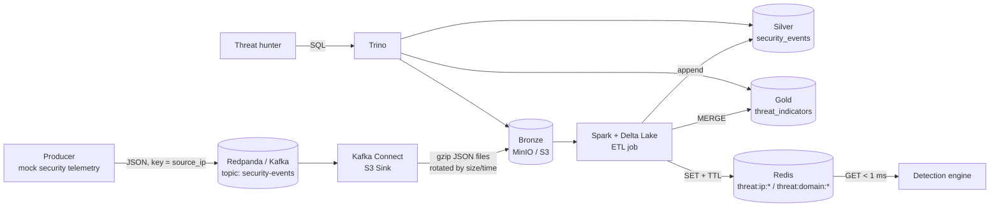

# Security Data Platform PoC

A local, fully containerized proof of concept of the data platform behind an
**email / web security product**: millions of security events per day, a
**sub-millisecond threat-intelligence lookup** for the detection engine, and an
**S3 data lake** for threat-hunting analytics.

Everything runs on a laptop with `docker compose`. Each component stands in for
the AWS managed service you'd use in production.

> Educational / portfolio project. It isn't affiliated with any security vendor,
> and all data is synthetic.

---

## Purpose

Security platforms need two things from the same event stream, and they pull in opposite directions:

| Need | Access pattern | Requirement |
|------|----------------|-------------|
| **Real-time detection**: "is this sender IP / URL domain malicious?" | Point lookup by key, on every email or request | < 10 ms, very high QPS |
| **Threat hunting**: "which users got phishing from this campaign last month?" | Ad-hoc SQL over large history | Flexible, cheap per TB, latency in seconds is fine |

No single database serves both well. This project builds a pipeline that feeds
a **hot path** (Redis) and a **cold/analytical path** (Delta Lake + Trino) from
one ingestion flow. Along the way it shows production concerns: decoupling,
the small-file problem, idempotency, partitioning, and resource sizing.

---

## Architecture



### Components

| Component | Simulates (AWS) | Role in the platform |
|-----------|-----------------|----------------------|
| **Producer** (Python, `confluent-kafka`) | Email gateways, web proxies, DNS sensors | Generates synthetic events (IPs, domains, senders, `threat_score`) with recurring "campaign" indicators, using an idempotent, batched, compressed producer |
| **Redpanda** (Kafka API) | Amazon MSK | Durable, partitioned event log. Decouples producers from consumers and absorbs traffic spikes. Keyed by source IP to keep per-IP ordering. |
| **Kafka Connect + S3 Sink** | MSK Connect / Kinesis Firehose | Buffers the stream and lands it in the lake as **few large files** (rotated by record count or time), partitioned `dt=/hr=`. Exactly-once object naming. |
| **MinIO** | Amazon S3 | Object storage for every lake layer (bronze, silver, gold) |
| **Spark 3.5 + Delta Lake** | AWS Glue | Incremental ETL: reads only new bronze files (checkpoint ≈ Glue job bookmarks), cleans the data, and writes to three sinks |
| **Redis** | Amazon ElastiCache | Serves malicious indicators as key/value pairs with TTL, for single-`GET` lookups (~0.3 ms measured) |
| **Trino** | Amazon Athena + Glue Data Catalog | Serverless-style SQL straight over the lake files (Hive catalog for bronze, Delta catalog for silver/gold) |

### Data layers (medallion)

| Layer | Content | Format | Consumer |
|-------|---------|--------|----------|
| **Bronze** | Raw events exactly as received from Kafka (+ partition/offset for lineage) | gzip JSON, `dt=/hr=` partitions | Replay / reprocessing, audit |
| **Silver** | One row per event: typed, normalized, validated, de-duplicated, flagged `is_malicious` | Delta Lake, partitioned by `event_date` | Threat hunters (Trino) |
| **Gold** | One row per malicious IP/domain: max score, category, hit count, first/last seen | Delta Lake, upserted with `MERGE` | Source of truth for Redis, dashboards |
| **Serving** | Gold indicators as `threat:<type>:<value>` → JSON, 7-day TTL | Redis | Detection engine |

### End-to-end flow

1. The **producer** publishes JSON events to the `security-events` topic (3 partitions).
2. **Kafka Connect** consumes the topic and writes a gzip JSON object per partition every 50,000 records or 60 s. 100k events end up as **6 files**, not thousands.
3. The **Spark job** (`spark/jobs/etl.py`) picks up only unprocessed bronze files and, per micro-batch:
   - appends cleaned events to **Silver**. The append is idempotent via Delta `txnAppId`/`txnVersion`.
   - aggregates malicious indicators and `MERGE`s them into **Gold**.
   - reads back the merged Gold rows and writes them to **Redis**, one connection and pipeline per partition.
4. The **detection engine** does `GET threat:ip:<ip>`. `nil` means unknown; a hit returns score and category, which drive the decision to block or quarantine.
5. **Analysts** query bronze/silver/gold with standard SQL in **Trino**.

---

## Key design decisions

- **Bronze buffer between Kafka and Spark.** It avoids the small-file problem, makes bronze an immutable replay source independent of Kafka retention, and lets ingestion and processing fail and scale independently.
- **Hot path vs cold path.** Redis for O(1) key lookups, lake + Trino for scans. Each store is used for the access pattern it's good at.
- **Idempotency at every hop.** Idempotent producer, offset-based S3 object names, Delta transactional appends, `MERGE` upserts, and idempotent bootstrap scripts.
- **Redis is derived from Gold.** The cache always reflects consolidated intelligence, and it can be rebuilt from the lake at any time.
- **Resource-bounded.** Every container has CPU/memory limits, sized so JVM heaps fit with off-heap headroom (~16 GiB total at the limits).

Trade-off: freshness of new indicators in Redis is **1–3 minutes** (file rotation + ETL schedule).
A sub-second requirement would add a parallel streaming path (e.g. Flink → Redis) next to this one.
See [docs/09-decisions-and-limitations.md](docs/09-decisions-and-limitations.md).

---

## Quickstart

Requirements: Docker with Compose v2, and ~16 GB RAM available to Docker (see [resources](docs/04-resources-and-tuning.md)).

```bash
# 1. Build and start (topic, bucket and connector are created automatically)
docker compose build && docker compose up -d

# 2. Produce 100k security events
docker compose run --rm producer --count 100000 --rate 5000

# 3. Wait ~90 s for Kafka Connect to rotate files into bronze, then run the ETL
docker compose exec spark /opt/spark/bin/spark-submit /opt/spark/jobs/etl.py

# 4. Low-latency lookup (detection engine path)
docker compose exec redis redis-cli --scan --pattern 'threat:ip:*' | head -1 \
  | xargs docker compose exec -T redis redis-cli GET

# 5. Analytics (threat hunting path)
docker compose exec trino bash /opt/scripts/register-tables.sh
docker compose exec trino trino -f /opt/sql/02_threat_hunting.sql
docker compose exec trino trino --catalog delta --schema lake   # interactive SQL
```

Stop with `docker compose down` (data is kept). `docker compose down -v` wipes everything.

| UI | URL |
|----|-----|
| MinIO console | http://localhost:9001 (credentials in `.env`) |
| Trino | http://localhost:8080 |
| Spark (while a job runs) | http://localhost:4040 |
| Kafka Connect REST | http://localhost:8083 |

---

## Repository layout

```
.
├── docker-compose.yml        # Whole stack, healthchecks, init containers, resource limits
├── producer/                 # Mock security event generator
├── kafka-connect/            # Connect image with the S3 Sink plugin + connector config
├── spark/                    # Spark + Delta image, ETL and maintenance jobs
├── trino/                    # Catalogs (hive, delta) and SQL (registration, hunting queries)
├── scripts/                  # Idempotent connector and table registration
└── docs/                     # Detailed documentation (start at docs/INDEX.md)
```

## Documentation

Full docs live in **[docs/INDEX.md](docs/INDEX.md)**: architecture, step-by-step runbook,
data model, resource tuning, bronze layer, Spark ETL internals, Trino usage,
operations/troubleshooting, and design decisions.

## Tech stack

Redpanda 24.2 · Kafka Connect 7.7 (Confluent S3 Sink 10.5) · MinIO · Apache Spark 3.5.3 ·
Delta Lake 3.2.1 · Redis 7.4 · Trino 470 · Python 3.12 · Docker Compose
