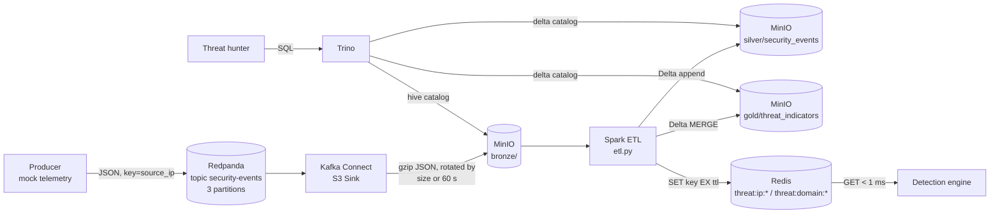

# 01 — Architecture

## Components and their AWS equivalents

| Role | Lab component | AWS service simulated | Container |
|------|---------------|-----------------------|-----------|
| Event broker | Redpanda 24.2 (Kafka API) | Amazon MSK | `redpanda` |
| Raw landing / buffer | Kafka Connect 7.7 + Confluent S3 Sink | MSK Connect / Kinesis Firehose | `kafka-connect` |
| Object storage (data lake) | MinIO | Amazon S3 | `minio` |
| ETL | Spark 3.5 + Delta Lake 3.2 | AWS Glue (Spark jobs + bookmarks) | `spark` |
| Low-latency serving | Redis 7.4 | Amazon ElastiCache | `redis` |
| Interactive SQL | Trino 470 | Amazon Athena | `trino` |
| Table catalog | Trino file metastore (in MinIO) | AWS Glue Data Catalog | (inside `trino`) |
| Event source | Python producer | Email gateways / web proxies / DNS sensors | `producer` |

## Data flow

## Medallion layers

| Layer | Location | Format | Written by | Purpose |
|-------|----------|--------|------------|---------|
| Bronze | `s3://datalake/bronze/security-events/dt=YYYY-MM-dd/hr=HH/` | gzip JSON lines (exact copy of Kafka payload + partition/offset) | Kafka Connect | Immutable raw record, replay source |
| Silver | `s3://datalake/silver/security_events/` | Delta (Parquet), partitioned by `event_date` | Spark | Cleaned, typed, de-duplicated events |
| Gold | `s3://datalake/gold/threat_indicators/` | Delta (Parquet) | Spark (`MERGE`) | One row per malicious IP/domain; source of truth for Redis |

## Why the extra bronze hop?

Spark does **not** read Kafka directly. Kafka Connect buffers the stream and
writes a few large files (by record count or time), so:

- Spark reads few, big files instead of committing tiny files per micro-batch
  (the "small-file problem").
- Bronze is a durable replay point that doesn't depend on Kafka retention.
- Ingestion and processing scale and fail independently. Spark can be down for
  hours, and Connect keeps landing data.

Trade-off: end-to-end latency for the Redis path is bounded by the rotation
interval plus the ETL schedule (about 1–3 min in this lab). If a detection engine
needs sub-second freshness for *new* indicators, that's handled by a separate
streaming path in production (see [09](09-decisions-and-limitations.md)).

## Network

All services share the `secdata` bridge network and talk to each other by
container name (`redpanda:9092`, `minio:9000`, `redis:6379`, …). Host-facing ports
are listed in [08-operations.md](08-operations.md).
